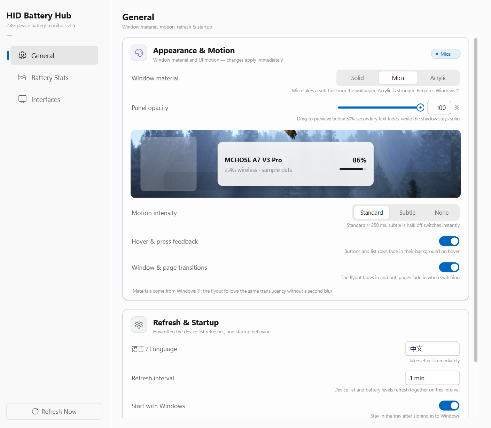

# HID Battery Hub

**English** | [中文](README.md)

A tiny Windows tray utility that reads the **battery level** of wireless mice, keyboards and controllers behind a 2.4G USB receiver (HID), and shows the lowest level right on the tray icon.

Single portable EXE — unzip and run. No drivers, no administrator rights.

Current version **v1.4** · [Download the latest release](https://github.com/StrelitziaZYN/HID-Battery-Hub/releases/latest)

## Features

- **Tray battery**: the icon fills by the lowest battery level — amber at ≤30%, red at ≤15%, with a bolt overlay while charging. No pop-ups, no interruptions.
- **Flyout panel**: click the tray icon to see every device — icon, name, connection type, battery, last update. Click elsewhere and it slides away.
- **Battery history**: 24-hour / 7-day / 30-day curves, recorded per device.
- **Endurance estimates**: based on the last **30 days** of charge/discharge records you get two numbers — "estimated time left" from the median drain rate of recent discharge segments, and "full-charge endurance" from the longest full-charge-to-0% cycle, with the median as reference.
- **Multi-vendor**: MCHOSE and Flydigi protocols are built in. For anything else, use the self-onboarding flow: *detect device → build prompt → hand it to an AI → drop the returned access bundle into the window*. No app update required.
- **Bring your own icons**: upload a PNG (auto-cropped to 128 px) per device. The app never fetches images from the internet.
- **Appearance & motion**: under *General* you can pick a window material (Solid / Mica / Acrylic) and a motion level
  (Standard / Subtle / None), and turn hover feedback or window/page transitions off separately. Materials are Windows 11
  system backdrops tinted by your wallpaper; on systems without them the app falls back to solid, never to unreadable translucency.
- **Panel opacity**: a 30–100% slider plus a numeric field, with a live preview that sits on your actual wallpaper and
  uses the very same fill routine as the real flyout. Only the panel fill becomes translucent — the drop shadow and
  rounded edge stay solid, so the panel never dissolves into the desktop.
- **Chinese & English UI**: switch under *General → 语言 / Language*; the whole interface, tray menu included, updates immediately.

## Screenshots

**Flyout panel** (click the tray icon)

**Settings window** (gear icon at the top right of the panel; three tabs on the left: General / Battery Stats / Interfaces)

General:

Battery Stats (the chart keeps a fixed 3:2 ratio and scales with the window):

Interfaces:

## Download & run

Grab the latest `win64.zip` from [Releases](https://github.com/StrelitziaZYN/HID-Battery-Hub/releases/latest), unzip it and double-click `HIDBatteryHub.exe`.
On first launch the app creates `config/ protocols/ assets/ data/` next to the EXE, so the EXE alone is enough when you move to another PC.
To take your settings and history with you, copy the whole folder.

## Language

Open *Settings → General → 语言 / Language* and pick **中文** or **English**. The switch applies immediately — the main window, the flyout panel and the tray menu are all rebuilt in the new language, and the choice is saved for next launch.

## Troubleshooting

**No icon in the tray?**
Windows hides new tray icons under the `^` overflow. Open `^` and drag the battery icon onto the taskbar to keep it visible.

**Devices have no icons?**
Icons only come from what you upload locally. In *Interfaces → Device Icons*, click ↑ and pick an image; devices of the same model share one icon.

**Battery won't read, or it stays on "Reading devices…"?**
Usually the device is asleep, or a vendor driver has claimed the receiver exclusively. Wake the device and hit refresh. After 15 seconds you'll see "Read timed out — will retry automatically" and the next round recovers on its own. If it still fails, open *Interfaces → Interface Debug* and click **Start Debug** to see whether the device replies at all.

**A device never shows up in the panel?**
It has no matching protocol yet. Click the device in the panel → build the prompt → paste it into any AI → drop the returned `.json` access bundle into the window. The plugin and profile install themselves; no re-download needed.

**Import says the plugin failed to register?**
Either the plugin code has a syntax error, or its `id` doesn't match `profile.protocol` inside the bundle. Fix the reported exception, or ask the AI for a fresh bundle.

**The percentage looks wrong?**
Field offsets differ between firmware builds. Edit that profile's *Advanced (JSON)* and adjust offsets such as `battery_index`.

**"Full-charge endurance" stays on "accumulating"?**
It needs one complete **full charge → drain below 20%** cycle, and the cycle must start at ≥90%. One or two cycles are enough to get a number; more cycles make it more accurate. Partial charges that stop halfway don't count.

**Where is my data stored?**
By default right next to the EXE: `config/` (profiles), `protocols/` (plugins), `assets/icons/` (device icons), `data/history.db` (battery history). The bottom of the Interfaces page shows the real paths and has an **Open Data Folder** button.
Only when the EXE sits in a non-writable folder (for example `C:\Program Files`) does everything move to `%LOCALAPPDATA%\HIDBatteryHub`, and the UI says so explicitly.

**How do I turn off auto-start?**
Use *General → Start with Windows*, or the **Launch at Startup** item in the tray context menu — the two stay in sync. It writes to the current user's `HKCU\...\Run` key, so no admin rights are needed.

---

See [CHANGELOG.md](CHANGELOG.md) for changes, [LICENSE](LICENSE) for the license.
