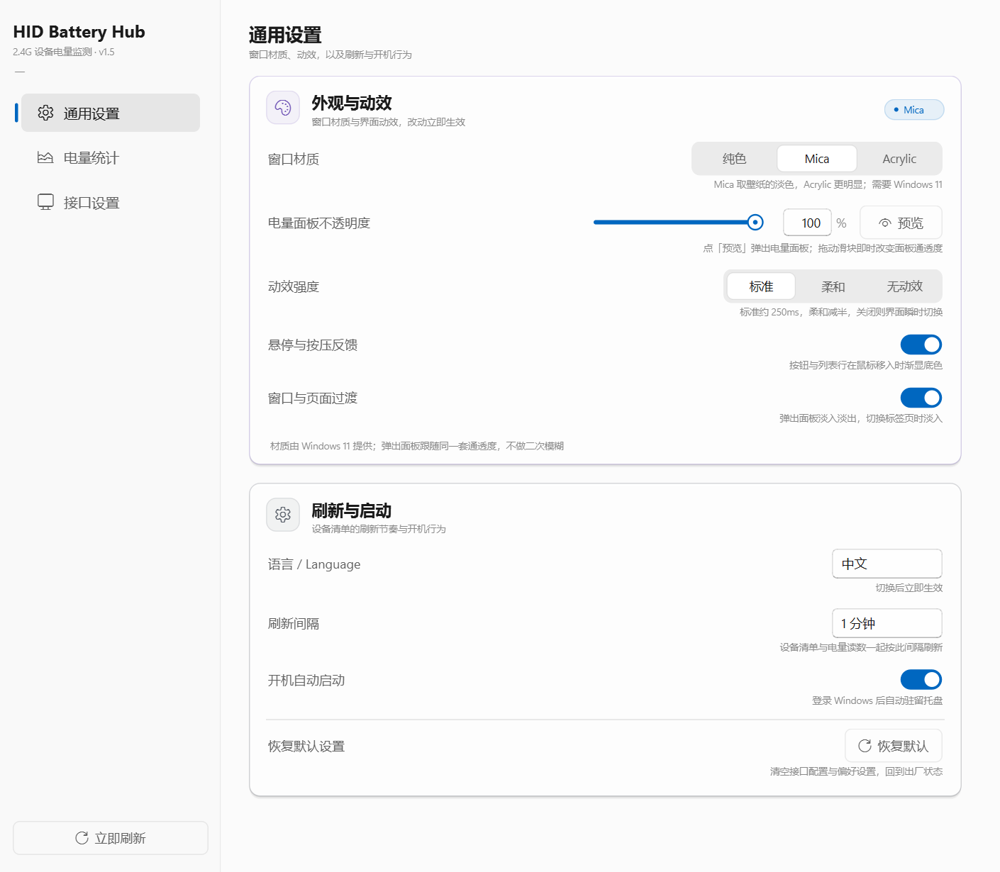

# HID Battery Hub

**中文** | [English](README.en.md)

Windows 托盘小工具：读取 2.4G 接收器（HID）后面无线键鼠、手柄的**电量**，最低电量直接显示在托盘图标上。

免安装单文件 EXE，解压即用，无需驱动、无需管理员权限。

当前版本 **v1.4** · [下载最新版](https://github.com/StrelitziaZYN/HID-Battery-Hub/releases/latest)

## 功能

- **托盘电量**：图标按最低电量填充，≤30% 变黄、≤15% 变红；充电时叠加闪电，不打扰、不弹窗。
- **悬浮面板**：点托盘图标弹出设备列表——图标、名称、连接方式、电量、更新时间，点空白处自动收起。
- **电量历史**：24 小时 / 7 天 / 30 天曲线，按设备独立记录。
- **续航估算**：按最近 **30 天**的充放电记录给两个数——「预计还能用」按各段放电速度的中位数算；「满电最长可用」取每次充满后放电循环折算到 0% 的最长一次，附中位值作参照。
- **多品牌支持**：内置迈丛 MCHOSE、飞智 Flydigi 协议；其它品牌可用「生成提示词 → AI 返回接入包 → 拖进去导入」自助接入，不用等更新。
- **图标自备**：设备图标由你自己上传（≤128px PNG），程序不联网抓图。
- **外观与动效**：设置 → 通用设置 可选窗口材质（纯色 / Mica / Acrylic）与动效强度（标准 / 柔和 / 无动效），
  还能单独关掉悬停反馈、窗口与页面过渡。材质是 Windows 11 的系统背景，取桌面壁纸的色调；
  系统不支持时自动回退纯色，不会出现半透明看不清的情况。
- **面板不透明度**：30%–100% 滑块 + 直接输数值，点「预览」在设置窗口旁弹出真实电量面板，
  拖动滑块时它同步变通透——看到的就是托盘里那一块。只调面板底色，投影与圆角保持不透明，
  低档位也不会找不到面板边界。
- **中英双语界面**：设置 → 通用设置 → 「语言 / Language」切换，主窗口、悬浮面板与托盘菜单即时更新。

## 界面

**悬浮面板**（点托盘图标）

**设置窗口**（面板右上角齿轮，左侧三个标签页：通用设置 / 电量统计 / 接口设置）

通用设置：

电量统计（图表固定 3:2，随窗口缩放）：

接口设置：

## 下载与运行

到 [Releases](https://github.com/StrelitziaZYN/HID-Battery-Hub/releases/latest) 下载最新的 `win64.zip`，
解压后双击 `HIDBatteryHub.exe`。首次运行会在 EXE 旁边生成 `config/ protocols/ assets/ data/` 四个目录，
换电脑只拷 EXE 也能跑；想连配置和历史一起带走就整个文件夹拷过去。

## 界面语言

打开「设置 → 通用设置 → 语言 / Language」，选 **中文** 或 **English**。切换后立即生效：
主窗口、悬浮面板和托盘右键菜单都会用新语言重建，选择会写入配置，下次启动保持不变。

英文说明见 [README.en.md](README.en.md)。

## 疑难解答

**托盘里找不到图标？**
Windows 默认把新图标折叠进任务栏的 `^` 里。点开 `^`，把电池图标拖到任务栏上即可常驻。

**面板里设备没有图标？**
图标只来自你本机上传。设置页「设备图标（本机上传）」里点 ↑ 选一张图片，同型号共用一张。

**读不到电量 / 一直是「正在读取设备…」？**
多半是设备休眠，或者接收器被厂商驱动独占。动一下设备唤醒后点刷新；超过 15 秒会提示「读取超时，稍后自动重试」，
下一轮会自动恢复。仍不行就到「设置 → 接口设置 → 接口调试」，点「开始调试」看回包里有没有数据。

**设备没出现在面板里？**
说明还没有对应协议。在面板点这台设备 → 生成提示词 → 贴给任意 AI → 把它返回的 `.json` 接入包拖进窗口导入，
插件和配置会自动装好，不用重新下载。

**导入报「未注册成功」？**
插件代码有语法错误，或 `id` 与接入包里的 `profile.protocol` 不一致。按提示里的异常改一下，或重新让 AI 生成一份。

**电量数字和实际不符？**
不同固件字段偏移可能不同。设置页编辑该接口的「高级参数 (JSON)」，调整 `battery_index` 等偏移即可。

**「满电最长可用」一直是「待积累」？**
它要一次完整的**充满 → 用到 20% 以下**才会记一次循环，且循环起点电量需 ≥90%。攒够一两次就会出数，
次数越多越准；只充到一半就拔掉不计入。

**数据存在哪？**
默认就是 **EXE 所在目录**：`config/`（接口配置）、`protocols/`（插件）、`assets/icons/`（设备图标）、
`data/history.db`（电量历史）。接口设置页底部会显示实际路径，点「打开数据目录」直达。
只有 EXE 放在不可写目录（如 `C:\Program Files`）时，才会整棵切到 `%LOCALAPPDATA%\HIDBatteryHub`，
界面上会标注「已切换」及原因。

**开机自启在哪关？**
设置页「通用设置 → 开机自动启动」开关，或托盘图标右键菜单里的「开机自启动」勾选项，两处同步。
写的是当前用户的启动项（`HKCU\...\Run`），不需要管理员权限。

---

变更记录见 [CHANGELOG.md](CHANGELOG.md)，许可见 [LICENSE](LICENSE)。
